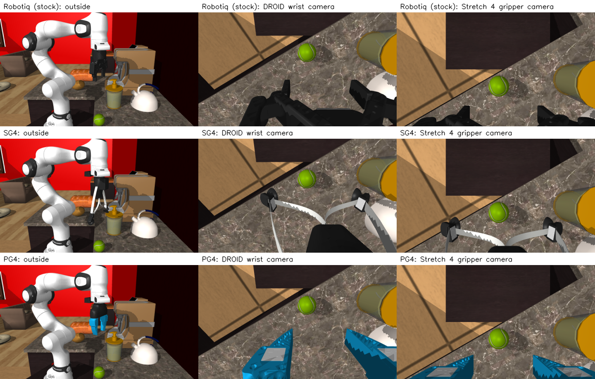

# MolmoBot-DROID on Stretch 4

These scripts run [MolmoBot-DROID](https://huggingface.co/allenai/MolmoBot-DROID), a
vision-language-action (VLA) policy trained on a Franka arm, on Stretch 4. Stretch 4 runs it in
simulation or on the real robot, by **retargeting**:

- The policy keeps believing it is driving a Franka.
- Each Franka action is converted to the pose of the Franka's tool center point (TCP).
- [`stretch4_kinematics`](https://github.com/hello-robot/stretch4_kinematics) inverse
  kinematics (IK) then finds the Stretch 4 joints that put Stretch's tool at that pose.
- Stretch's measured joints are mapped back to Franka joints for the policy's state input.

Stretch 4 is always built and simulated by this repository's `stretch4_mujoco` library.
Scenes, objects and benchmarks come straight from
[MolmoSpaces](https://github.com/allenai/molmospaces).

## General notes about working the MolmoBot-DROID

1. The models was trained on the Franka arm with the Robotiq gripper (7 + 1 DOF). There is the gripper camera biased downwards toward the fingertips, and an external workspace camera.
1. Start pose matters in several ways:
  1. The model appears to expect the designated object for the Pick task to be placed in the center of the external workspace camera's image. https://drive.google.com/file/d/1666P8Ibm3BvpkZksR3lRXz-oTUEQ9aJr/view?usp=drive_link. The video they released also seems to corroborate this https://youtu.be/UQVX0iq67mo?si=vIu8OKx8puLBfobU&t=77. When using the cropped fisheye camera, it has no problem picking up the when it’s not in front of the base, but the object still has to be in the center of the exo camera view - the fisheye camera in this case: https://drive.google.com/file/d/1NYUDZv7g_yTa-e6K60OpQR6XdLgLtIZz/view?usp=drive_link 
  1. If the gripper starts lower than the object or in a horizontal pick up pose, it seems unable to pick up the object: https://drive.google.com/file/d/1efDto5MsmVed2zsQwyd5vhXIxGuRHD7B/view?usp=drive_link A flipped wrist seems alright.
  1. Flipping wrist by ~180 degrees is not good, especially if the exo camera can’t see the object:  https://drive.google.com/file/d/1_w4qASun-bhj37VMnFc6YTgwrRHu8FA4/view?usp=drive_link 
  1. Pedestal z-height does not appear to affect performance https://drive.google.com/file/d/1nX413Xc9PtzQZiFrpdQP8TwSUiAtxY8J/view?usp=drive_link 
 

   

## The model

| | |
|---|---|
| Checkpoint | `allenai/MolmoBot-DROID`, Apache-2.0. Sim-only training, no real robot data. Called "MolmoBot (F=2)" in the [paper](https://arxiv.org/abs/2603.16861). |
| Network | Molmo2-4B: SigLIP2 so400m vision encoder and a Qwen3-style 36-layer LLM, plus a flow-matching action expert (10 integration steps). |
| Robot | Franka FR3 with a Robotiq 2F-85 gripper, on a pedestal. Model: molmospaces `franka_droid`. |
| Images | Exo camera, then wrist camera. Each shows the current frame and the one 8 control steps earlier, so 4 images per query. |
| Image size | 640x368, the size molmospaces renders the training cameras at (`FrankaDroidCameraSystem`). The MolmoBot demo notebook uses 640x360 and the benchmark JSON lists 624x352; the model resizes anyway. |
| State | 8 values: the 7 FR3 joint angles plus the Robotiq `left_driver_joint` angle (0.003 open to 0.824 closed). |
| Action | A chunk of 16 actions, each 8 values. The first 7 are absolute FR3 joint positions in radians. The last is the gripper command, 0–255, thresholded at 128 to open (0) or closed (255). |
| Rate | 15 Hz (66 ms per step). |
| Safety | Each executed step is limited to 0.2 rad per joint, measured from the current state (DROID's IK limit). |
| Training cameras | The `franka_one_random_then_wrist` preset: the exo camera is a randomized ZED 2 stand-in placed around the workspace (50–90° FOV), not just the fixed DROID shoulder camera. |
| Training height | The Franka is placed relative to the object, not the floor. Its mocap base sits at object z − 0.75 m, plus noise from U(−0.30, 0.25), under a 0.58 m pedestal. So `fr3_link0` is about 0.17 m below the object. |
| Tasks | `pick` (the focus here), `pick_and_place`, `pick_and_place_next_to`, `pick_and_place_color`, `open`, `close`. See `checkpoint.TASKS` for the instruction templates. |
| Memory | About 10 GB of VRAM in bf16, peaking near 11 GB during inference. About 0.2–0.3 s per query on an RTX 5090. |

Measured here:

- Loading takes about 12 s once the weights are cached.
- `close()` brings VRAM back to a few MB.
- If memory fragments, set `PYTORCH_CUDA_ALLOC_CONF=expandable_segments:True`.

### Loading and releasing it

The Hugging Face repo has only the weights: `model.pt` (19 GB) and an OLMo `config.yaml`. The
network is defined in MolmoBot's `olmo` package. MolmoBot requires Python 3.11 and this repo
uses 3.12+, so it is not pip-installed:

- `checkpoint.ensure_molmobot_code()` clones `allenai/MolmoBot` at a pinned commit into
  `~/.cache/molmobot/` and imports it by path.
- Set `MOLMOBOT_PATH` to use your own checkout instead.
- Its runtime dependencies are in this repo's `molmobot-droid` extra.

```python
from examples.vla.molmobot_droid.checkpoint import load_policy, build_instruction

with load_policy() as policy:          # frees the GPU on exit
    policy.reset()                       # per episode
    policy.add_observation(exo, wrist)   # every executed step
    chunk = policy.predict_chunk(state8, build_instruction("pick", "red mug"))
```

`load_policy()` keeps a single cached model, so a second call reuses it. Loading a different
checkpoint frees the first one, and `unload_policy()` frees it explicitly. The observation
history is capped at the 9 frames a query can reach.

## Setup

```bash
uv sync --inexact --extra molmo --extra molmobot-droid
```

On Linux the extra pulls torch from the CUDA 12.8 index. Blackwell GPUs (RTX 50xx) need it.

The first run downloads:

- the checkpoint, into the Hugging Face cache;
- the MolmoBot code;
- each house's assets, into the MolmoSpaces cache.

## Retargeting (`franka_retarget/stretch4_retarget.py`)

Diagrams of the retargeting and of the two Stretch 4 runners are in
[`franka_retarget/README.md`](franka_retarget/README.md).

```
Franka q (7) ──FK──> grasp_site pose ──fr3_link0 in world──> world
   ──TCP_ALIGN · grasp offset──> where Stretch's grasp_center_link should be
   ──into Stretch's current base_footprint──> stretch4_kinematics IK
   ──> base rotation, lift, arm, wrist yaw/pitch/roll   (+ gripper open/close)
```

- **Where the virtual Franka stands.** `fr3_link0` sits above Stretch's starting
  `base_footprint`, facing the same way. Its height is the training height for the target
  object.
  - The head cameras transplanted onto the Franka (`--exo_camera left|right|center`) sit at the
    same place relative to that floor point, with joint 1 at 0. They hang off `fr3_link1`, so
    they turn with joint 1 the way Stretch's head turns with its base.
  - Note that `base_link` in Stretch's model is 0.028 m above `base_footprint`. The footprint is
    the reference.
- **Degrees of freedom.** IK solves 6 DOF for a 6-D pose: base rotation, lift, arm, and wrist
  yaw, pitch and roll. Base translation is not used.
- **Out of reach.**
  - When Stretch cannot reach a target, the closest pose within 5 cm / 20° is used and counted
    as `ik_clamped`.
  - More than 20° off, it takes the target turned the least it needs (up to 60°) about the
    tool's approach axis, keeping the position (`ik_twisted`).
  - Beyond that it holds still and the step counts as an `ik_failure`. On the real robot,
    `--recover-after` of those in a row (default 10) send it back to the start pose.
  - The common case is the Franka's home pose over a tall counter. Stretch's lift tops out
    about 0.12 m short of a downward-pointing Franka TCP there.
- **Back to the Franka.** Stretch's tool pose, with the grasp offset taken back out, goes
  through damped least squares IK on the Franka. It is seeded with the previous solution so
  the redundant elbow doesn't flip.
- **TCP frames.**
  - Franka `grasp_site`: approaches along +z, fingers on y.
  - Stretch `grasp_center_link`: approaches along +x, fingers on y.
  - `TCP_ALIGN` maps one onto the other, which also puts both wrist cameras on the same side.
- **Arm offset.**
  - stretch4_kinematics puts the tool 40.75 mm further out than the URDF for the same arm
    extension.
  - Cause: stretch4_urdf's `merge_arm()` sums `joint.origin[3, :3]` (the homogeneous row)
    where it means `joint.origin[:3, 3]`.
  - `measure_arm_offset()` measures this against the URDF and corrects for it, so it stays
    right once that is fixed.
- **Wrist roll range.**
  - The robot (stretch4_body `range_deg: [-65, 245]`) and the simulator (`FLIP_WRIST_ROLL_RANGE`)
    roll from −65° to 245°. The URDF, and so stretch4_kinematics, has that mirrored.
  - The retargeter overrides the limit in its own copy of the kinematics model.
  - IK is multi-start (current joints, then a few canonical wrist poses), so it finds e.g.
    roll +180° rather than stalling at −65°.
- **Wrist orientation.**
  - The mapping is camera-aligned: Stretch's gripper camera sees what the Franka's wrist
    camera would, the right way up, and the grasp is never turned the other way round.
  - That puts Stretch's roll near 180° for the Franka's usual downward grasp. The first solve
    after a reset, i.e. the start pose, takes the solution with the most room to the wrist
    limits (yaw ≈ 0°, pitch ≈ 90°, roll ≈ 180°).
  - After that, IK takes the exact solution closest to the current joints, keeping 0.15 rad
    clear of a wrist limit where it can.
  - Where the Franka's grasp needs more roll than Stretch's 245°, Stretch goes to the closest
    pose within 5 cm / 20° (`ik_clamped`), then to the grasp turned less (`ik_twisted`), or
    holds (`ik_failure`).
- **Parallel gripper.**
  - IK always runs on stretch4_kinematics' Stretch-gripper model. Its PG4 support is only on an
    unpublished branch.
  - For PG4, the target is shifted by the PG4's TCP relative to the Stretch gripper's. That
    transform comes from the two URDFs: 68.1 mm along the approach axis. Everything before the
    wrist roll is identical for both tools.
- **Where Stretch starts.**
  - Stretch spawns with its lift 90% up (1.08 m). The other joints are at the model's home pose.
  - Both its initial joint position and the model's `home` keyframe, which
    `Stretch4MujocoSimulator.start()` homes to, are set to that lift height.
  - It then moves to the Franka's start pose before the policy runs.
  - At the model's lift of 0, the gripper would often start under a table and homing would
    drive it up into it.

### Flags (Stretch 4 scripts)

| Flag | Default | |
|---|---|---|
| `--slow` | off | Every joint at 20% of its default speed. |
| `--wait-for-arrival / --no-wait-for-arrival` | on | Wait for each action to arrive (`wait_command()`) before the next. Never less than one 66 ms step. |
| `--head-crop droid\|none` | `droid` | Center-crop head images to the 640:368 aspect, then resize to 640x368. |
| `--rectify` | off | Redraw the left/right head fisheye as the DROID exo camera would see it (a 640x368 pinhole, 71° high, on the fisheye's axis) instead of only cropping it, so things are DROID's size out to the edges. Also in `run_franka.py` (`--exo_camera left\|right`) and `run_follow_franka.py` (Stretch's fisheye views in Rerun). See [the policy's images](franka_retarget/README.md#the-policys-images-every-crop-and-resize). |
| `--execute-horizon` | 8 | How many of the 16 predicted actions to keep. |
| `--execute-horizon-do-only-first-n-steps` | 8 | Execute this many of those, then query again. |
| `--use_parallel_gripper` | off | Stretch 4 with the parallel jaw gripper (PG4) instead of the Stretch gripper (SG4). Sim only: `run_stretch4_real.py` uses the gripper the robot reports. |
| `--grasp-offset-mm x,y,z` | `-9,0,0` with SG4; `4,0,0` with PG4 | Stretch's tool relative to the Franka TCP, in the TCP frame (x = approach, y = between the fingers). The defaults line each tool's fingers up with the Robotiq's. The policy never sees it. |
| `--grasp-offset-deg roll,yaw,pitch` | `0,0,0` | The same, rotations about x, z and y. |
| `--exo_camera droid\|left\|right\|center` | `left` | The policy's exo view. `droid` is the DROID shoulder camera where the virtual Franka's would be (sim only). |
| `--gripper_camera left\|right` | `left` | Which gripper camera stands in for the wrist camera. |
| `--apply_franka_gripper_image_mismatch_fix` | off | Show the policy the gripper camera image as DROID's wrist camera would see the scene: a homography for the 19.5° pitch and focal length difference between the cameras, exact on the plane through the grasp point (what is between the fingers), Stretch's fingers filled out, and the Robotiq drawn in (`franka_retarget/gripper_image_fix.py`). Further out, the cameras being apart leaves parallax: about 30 px at 5 cm past the grasp point, 50 px at 30 cm (against about 110 px without the fix). On the real robot it undoes the gripper camera's lens distortion with its calibration. **For now the left gripper camera's is hardcoded** (`HARDCODED_CALIBRATIONS`, stretch-se4-4024's, used on every robot), and so is how that camera is turned from the model's (`HARDCODED_CAMERA_CORRECTIONS`: 5.4° further down toward the fingers, fitted to the PG4's fingertip tags in one screenshot); otherwise it uses the factory calibration the publisher sends with the images (`camera_matrix`, `distortion_coefficients`), and warns if there is none. Also in `run_franka.py`, with `--use_stretch4_gripper` and `--use_stretch4_gripper_camera`. Not with `--overlay_franka_gripper` or `--use_franka_gripper_camera`. |
| `--include_franka` | off | Overlay the Franka being driven: see-through, no collisions. Moving in Rerun and the scene camera. In MuJoCo's viewer it is static at home, in geom group 5 (press `5` to show it). It is in group 5 so that none of Stretch's cameras, and so not the policy, can see it. |

## Scripts

All are run as modules from the repo root, e.g. `python -m examples.vla.molmobot_droid.run_franka`.

| Script | |
|---|---|
| `run_franka.py` | Franka DROID in a MolmoSpaces house (`--scene-id procthor-10k/val/0 --object-type mug`). Type instructions; watch in the passive viewer and Rerun. `--use_stretch4_gripper` and `--use_stretch4_gripper_camera` swap in Stretch 4's hardware (see below). |
| `run_stretch4_sim.py` | The same with Stretch 4, plus all the flags above and `--include_franka`. |
| `run_stretch4_real.py` | The real robot (`--robot_ip`), run continuously: type an instruction + Enter and it works on it until told otherwise. Typing another instruction switches to it; Enter or Space on an empty line stops the robot; `home` raises the lift and returns to the start pose; `quit` or Ctrl+C exits. `--max-steps` (default 0, unlimited) caps an instruction. Needs `send_gripper_and_head_images_with_joint_states.py -r` from stretch4_compliant_gripper running on the robot, with the camera sides matching the flags. `--object-height` sets the virtual Franka's height. |
| `run_benchmark_franka.py` | A MolmoSpaces benchmark on the Franka (default `FrankaPickDroidMiniBench`). `--list` shows what is installed. |
| `run_benchmark_stretch4.py` | The same benchmark on Stretch 4. Its footprint goes where each episode puts the Franka's base. Furniture Stretch would spawn inside is removed and listed (`furniture_removed` in the report). The Franka's pedestal there is a mocap body, which static chairs never push on. |
| `compare_benchmarks.py` | `--franka <run> --stretch4 <run> [--stretch4 <run> ...]`, or `--all <dir>` for every run in it: `comparison_report.md`; with `--videos`, each episode's grid videos stacked vertically. |
| `run_follow_franka.py` | The policy drives the Franka while Stretch 4 follows it blind (see [Following the Franka](#following-the-franka-data-for-fine-tuning)). The console works as in `run_stretch4_sim.py`. Type an instruction; it runs until Stretch picks the object up, and Enter or Space stops it. `home`/`reset`, `jog`, `set`, `pose`, `height` and `offset` move the Franka, and Stretch follows. `stats` prints how closely Stretch has followed. |
| `run_benchmark_follow_franka.py` | A benchmark run the same way. It saves each episode Stretch succeeds in as a Stretch 4 trajectory for `run_finetune.py`. |
| `run_finetune.py` | Fine-tunes MolmoBot-DROID on those trajectories to drive Stretch 4's joints directly (see [Fine-tuning](#fine-tuning-on-stretch-4-run_finetunepy)). |

A benchmark run writes to `outputs/molmobot_droid/<run name>/`. The run name is the robot
plus the flags, joined with underscores, e.g.
`stretch4_exo-left_grip-left_eh-8_n-2_crop-droid_slow-0_wait-1_pg-0_offmm--9,0,0_offdeg-0,0,0_ghost-0`.
The directory contains:

- `<run name>_ep<#>_<camera>.mp4` for each camera: `exo` and `wrist` (what the policy saw),
  `head_raw` and `gripper_raw` (Stretch), and `scene`;
- `<run name>_ep<#>_grid.mp4`, all of them tiled;
- `report.md` and `results.json`.

Episodes are named by their index in the benchmark, e.g. `ep0003`. That name is printed for
each episode and used in the video file names.

**Ctrl+C** stops a benchmark run cleanly:

- The simulator is closed, and the interrupted episode is not counted.
- `report.md` and `results.json` are written for the episodes finished so far. The report
  notes where the run stopped.
- The exact command to continue is printed, with `--resume ep0003`.

**Resuming** reruns from that episode onward, into the same run directory. Results from before
it are kept, so the final report covers the whole run.

Success uses molmospaces' criteria:

- **Pick:** the object is lifted at least 1 cm and touches only the robot.
- **Pick-and-place:** the object rests on the receptacle, the robot has let go, and the
  receptacle moved at most 15 cm.
- **Open/close and next-to:** not implemented yet.

On Stretch 4, success reads object poses and contacts through `sim.watch_bodies()`,
`pull_body_poses()` and `pull_body_contacts()`.

### Trying start poses on the Franka

`run_franka.py` keeps simulating between instructions, so the arm can be moved before the
policy takes over:

1. Run `python -m examples.vla.molmobot_droid.run_franka`.
2. Type `jog` and use the arrow keys to change the start pose: left/right (or `1`-`8`) picks
   a joint, or the pedestal after joint 7, and up/down moves it. `[` and `]` halve or double the
   step (degrees, or cm for the pedestal), `g` opens or closes the gripper, and `h` goes home.
   The cameras stream to Rerun while jogging.
3. Press Enter. The pose is printed as `set ...` and `height ...` lines; paste them at the
   prompt later to return to it.
4. Type an instruction. Ctrl+C stops it.

Other commands at the prompt: `pose` prints the arm's joints and pedestal height,
`set q1 ... q7` (rad) and `home` jump the arm there, `height <m>` sets the pedestal height
(0.1–1.5 m), and `reset` resets the whole scene, keeping the pedestal height. A head exo camera
(`--exo_camera left|right|center`) stays where it is when the pedestal moves; the `droid` one
moves with the arm. In MuJoCo's viewer, the arm also
follows its Control sliders, or, while paused (Space), its Joint sliders.

### Stretch 4's gripper and gripper camera on the Franka

These two flags test whether the policy copes with Stretch 4's gripper and gripper camera on
the robot it was trained on. That separates their effect from everything else retargeting
changes.

```bash
python -m examples.vla.molmobot_droid.run_franka --use_stretch4_gripper pg4 --use_stretch4_gripper_camera
```

- `--use_stretch4_gripper sg4|pg4` replaces the Robotiq with the Stretch gripper (SG4) or the
  parallel gripper (PG4).
- `--use_stretch4_gripper_camera` makes Stretch 4's left gripper camera the policy's wrist
  camera, instead of DROID's.
- `--apply_franka_gripper_image_mismatch_fix`, with both, warps that camera's image into DROID's
  wrist camera's view, as the Stretch 4 scripts do. Rerun's `franka_wrist` shows what it should match.

Either flag works alone. Both parts are mounted on the Franka's flange as they are on Stretch
4's wrist:

- **Gripper:** the tool's `quick_connect_interface_link` (its mating face; all of the tool is in
  front of it) goes on the flange, where the Robotiq's `gripper/base` attaches. It is turned as
  retargeting turns the tool to the Franka's TCP (`TCP_ALIGN`): it approaches along the flange's
  axis, with the fingers on the Robotiq's finger axis.
- **TCP:** the policy's TCP, `grasp_site`, stays where the Robotiq's is, 155 mm from the
  flange. The tool's own grasp center ends up further out: 235 mm for SG4 and 167 mm for PG4.
  Retargeting's grasp offset does not apply here.
- **Camera:** it goes where it is on Stretch 4 relative to the quick connect, 57 mm off the
  flange's axis on the side DROID's camera is. That is the same for either tool, so it is the
  same with the Robotiq kept.
- **Gripper command and state:** these stay in the Robotiq's units (0–255 command, driver angle
  0.003–0.824). They are converted to and from the Stretch fingers as retargeting does, so a
  grasp that stops on an object reads as partly closed.
- **Wrist image:** rendered with stretch4_mujoco's intrinsics (640×400), then DROID-framed to
  640×368, as in retargeting.

The camera's housing reaches 24 mm behind the mating face, beside `fr3_link7`, where on Stretch
the wrist roll is. So:

- none of Stretch's parts collide with the Franka's arm they are mounted on (they still collide
  with the scene);
- the Franka's arm is hidden from the Stretch gripper camera. The exo and scene cameras still
  show it.



The Franka is at home over a counter (`procthor-10k/val/0`, `--object-type tennis_ball
--in-place-of toaster`), with the tennis ball moved to straight under its TCP. Each row is one
gripper: the stock Robotiq, SG4 and PG4. The columns show:

1. The outside view. The SG4 and PG4 rows also have the Stretch camera on (the black housing).
2. DROID's wrist camera (`--use_stretch4_gripper` alone).
3. Stretch 4's gripper camera (with `--use_stretch4_gripper_camera`).

The camera images are what the policy is given.

The code is in `franka_retarget/stretch4_hardware_on_franka.py`. It cuts Stretch 4's MJCF down
to the wrist roll body, holding the tool and/or the camera, and attaches that to the Franka's
emptied `gripper/base`, the quick connect on its origin. `gripper/base` keeps `grasp_site` and
DROID's wrist camera.

## Following the Franka (data for fine-tuning)

`run_follow_franka.py` and `run_benchmark_follow_franka.py` turn the Franka's episodes into
Stretch 4 demonstrations (`franka_retarget/follow_franka.py`):

- **The policy drives a Franka.** It sees only the Franka's DROID exo and wrist cameras. They
  are rendered in the house Stretch's simulator runs, with the Franka drawn where its joints are
  and Stretch hidden. Its state is the Franka's own joints, not Stretch's mapped back.
- **The Franka touches nothing.** It is simulated alone, in a model of its own, so its joints
  move as on the Franka DROID. Only Stretch 4 moves objects.
- **Stretch follows blind.** Each Franka action is retargeted as in `run_stretch4_sim.py`. The
  same flags apply, except the camera ones: `--slow`, `--wait-for-arrival`, the execute
  horizon, `--grasp-offset-mm/-deg`, `--use_parallel_gripper` and `--custom_franka_start_pose`.
- **The gripper state comes from Stretch.** The Robotiq would close on nothing, while Stretch's
  fingers stop on the object they hold. So the state's gripper value is Stretch's opening
  (`robotiq_driver_angle()`), and the Robotiq is drawn closed that far.
- **Success is judged on Stretch.** It is molmospaces' pick criterion: the object lifted 1 cm
  and touching nothing but Stretch.

Every camera of Stretch's is recorded, raw and as a policy would be shown it:

| Video | |
|---|---|
| `fisheye_left`, `fisheye_right` | The head fisheyes, DROID-framed (`--head-crop droid`'s crop to 640x368). `_raw`: as rendered, 1200x1920 upright. |
| `center` | The center head camera, as rendered: the simulator's low-resolution one, 965x1280 upright. |
| `gripper_left`, `gripper_right` | The gripper cameras as the retargeted policy's wrist view (640x368). `_raw`: as rendered, 640x400. |
| `exo`, `wrist` | What the policy saw: the Franka's cameras. |

The grid videos show the Franka's views, Stretch's cropped ones and the scene camera. In the
scene camera, the Franka is see-through over Stretch. The report adds the mean and maximum
distance between Stretch's tool and where the Franka's action put it (`tool_error_mean_m`,
`tool_error_max_m`), and whether a trajectory was saved (`saved`).

For each successful episode, `run_benchmark_follow_franka.py` also writes
`<run>_ep<#>.h5` next to its videos (`finetune/dataset.py`). It is laid out as molmospaces'
trajectories are, so MolmoBot's trainer reads it as is:

- `traj_0/obs/agent/qpos` and `traj_0/actions/joint_pos` hold Stretch's state and joint targets
  per step, as JSON per move group.
- `traj_0/obs/sensor_data/<video>` names each video above.
- `traj_0/stretch4/` holds the same as plain arrays, plus the Franka's states and actions,
  Stretch's base pose, and whether each action was reached, clamped, twisted or unreachable.

Stretch's 8 values (`finetune/stretch4_joints.py`) are the joints retargeting moves, in the
Franka's slots: base heading (from the episode's start), lift, arm, wrist yaw, pitch and roll,
an unused 0, and the gripper. The gripper state is the driver angle; the gripper action is 0
open or 255 closed.

```bash
python -m examples.vla.molmobot_droid.run_follow_franka --use_parallel_gripper --custom_franka_start_pose
python -m examples.vla.molmobot_droid.run_benchmark_follow_franka --use_parallel_gripper \
    --custom_franka_start_pose --no-wait-for-arrival --max-episodes 200 --no-rerun
```

## Fine-tuning on Stretch 4 (`run_finetune.py`)

`run_finetune.py` fine-tunes MolmoBot-DROID with MolmoBot's own trainer (`finetune/train.py`).
The fine-tuned policy's state and actions are Stretch's 8 values above. Its exo view is a head
fisheye (`--use_fisheye left|right`, DROID-framed) and its wrist view a gripper camera
(`--use_gripper left|right`). As in MolmoBot-DROID, each query sees 2 frames per camera, 8 steps
apart.

`--use_parallel_gripper` picks the PG4 trajectories; without it, the SG4 ones. Everything else
about the model is the checkpoint's own config. Only the normalization is new: it is computed
from the data into `norm_stats.yaml` on the first run.

What is trained:

| Flag | Default | |
|---|---|---|
| `--use_action_head / --no-use_action_head` | on | The flow-matching action expert. Its 8 outputs keep their shape, so its pretrained weights load. |
| `--use_vision_transformer / --no-use_vision_transformer` | off | The SigLIP2 encoder and its connector into the LLM. Training them backpropagates through the whole LLM, so each step costs several times as much. |

The LLM is always frozen. Its weights stay in fp32 (FSDP2 keeps fp32 master weights; bf16 is
only for compute), about 20 GB for the whole model. With the LLM's gradients too, it would not
fit in 32 GB.

The optimizer is bitsandbytes' 8-bit AdamW. Its kernels refuse FSDP2's sharded (DTensor)
parameters, so `LocalShardAdamW8bit` steps each one's local shard. On one GPU that is the whole
parameter, and checkpoints save and resume its state as usual.

Other defaults: 50,000 steps, a batch of 32 in micro-batches of 8, and 10% of the episodes held
out for validation loss. Options after `--` go straight to MolmoBot's TrainConfig, e.g.
`-- --optimizer.action_expert_learning_rate=3e-5`. `--debug` runs a tiny, randomly initialized
model to check the pipeline end to end.

Output goes to `outputs/molmobot_droid/finetune/<run>/`:

- `dataset/`: links to the run directories, split train/val, with each split's index;
- `norm_stats.yaml` and `spec.json`;
- sharded checkpoints every `--save-interval` steps. To resume, run the same command again;
- the final `step<N>-unsharded/`, which `checkpoint.load_policy()` loads.

```bash
python -m examples.vla.molmobot_droid.run_finetune --use_parallel_gripper \
    --data outputs/molmobot_droid/follow_franka_eh-8_n-8_slow-0_wait-0_pg-1_offmm-4,0,0_offdeg-0,0,0_customstart-1
```

### Setup

MolmoBot pins Python 3.11, so training runs in its own venv, in the git-ignored clone that
`checkpoint.py` also loads the model code from. The lock's torch is the CUDA 12.6 build, which
has no kernels for Blackwell GPUs (RTX 50xx). Replace it with the cu128 build:

```bash
git clone https://github.com/allenai/MolmoBot.git examples/vla/molmobot_droid/molmobot
cd examples/vla/molmobot_droid/molmobot/MolmoBot
uv sync --extra train --python 3.11
uv pip install --python .venv/bin/python --reinstall-package torch --reinstall-package torchvision \
    --reinstall-package torchaudio torch==2.7.1 torchvision==0.22.1 torchaudio==2.7.1 \
    --index-url https://download.pytorch.org/whl/cu128
uv pip install --python .venv/bin/python bitsandbytes
```

Run `run_finetune.py` itself from this repo's venv. It launches torchrun in MolmoBot's venv.
Don't `uv sync` there again, or it puts the cu126 torch back.

## Tests

```bash
python -m pytest tests/test_molmobot_droid.py tests/test_body_states.py
python -m pytest examples/vla/molmobot_droid/franka_retarget/test_retargetting.py -s
```

`test_retargetting.py` opens Rerun; set `RERUN_SAVE=<file.rrd>` to record instead.

- It overlays the Franka on Stretch 4, for both grippers, using each robot's own MuJoCo model.
- The poses come from Stretch joint values spread over lift 0.25–1.1 m, arm 0–0.5 m and the
  wrist's whole range, mapped back to Franka poses the Franka can also reach.
- It commands the Franka through 40 of them and has Stretch follow from wherever it is.
- At every pose it asserts the tools match (within 3 mm and 1°) and that mapping Stretch back
  recovers the Franka's TCP.

## Files

| File | |
|---|---|
| `checkpoint.py` | Download, load and release the model; task instructions. |
| `droid.py` | Franka spawning (molmospaces' own `FrankaRobot`), exo cameras, the ghost, Franka FK/IK, the in-process Franka env. |
| `molmospaces/custom_scene.py` | Any house plus target object, for either robot; picking a robot pose; the client-side `SceneMirror` that renders cameras Stretch's simulator doesn't have. |
| `molmospaces/benchmark.py` | Benchmark episodes, success checks, recording and reports. |
| `franka_retarget/stretch4_retarget.py` | Retargeting, its flags, and the Stretch 4 sim env. |
| `franka_retarget/stretch4_hardware_on_franka.py` | Stretch 4's gripper and gripper camera on the Franka (`run_franka.py --use_stretch4_gripper`, `--use_stretch4_gripper_camera`), driven in the Robotiq's units. |
| `franka_retarget/test_retargetting.py` | The 20-pose retargeting test, shown in Rerun. Its `conftest.py` stops the repo root, which is a package named `stretch4_mujoco`, from shadowing the library under pytest. |
| `rollout.py` | The query/execute loop and the interactive prompt. |
| `rerun_scene.py` | The Rerun view: the whole house in 3D from the simulated model, cameras, tool target vs. actual. |
| `franka_retarget/follow_franka.py` | Stretch 4 following the Franka blind: the env, Stretch's recorded views, saving trajectories. |
| `finetune/stretch4_joints.py` | Stretch 4's joints as the policy's 8 state and action values. |
| `finetune/dataset.py` | The trajectory h5 files, and the train/val directory MolmoBot reads them from. |
| `finetune/train.py` | MolmoBot's trainer with Stretch's presets, the checkpoint's own model config, 8-bit AdamW and the optional frozen action expert. It runs in MolmoBot's venv. |
