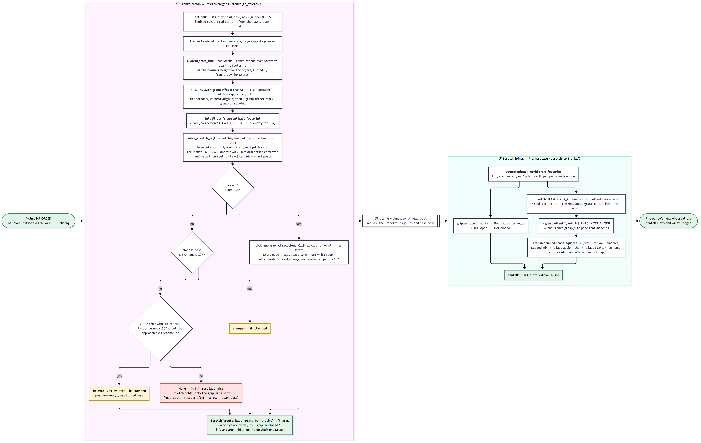
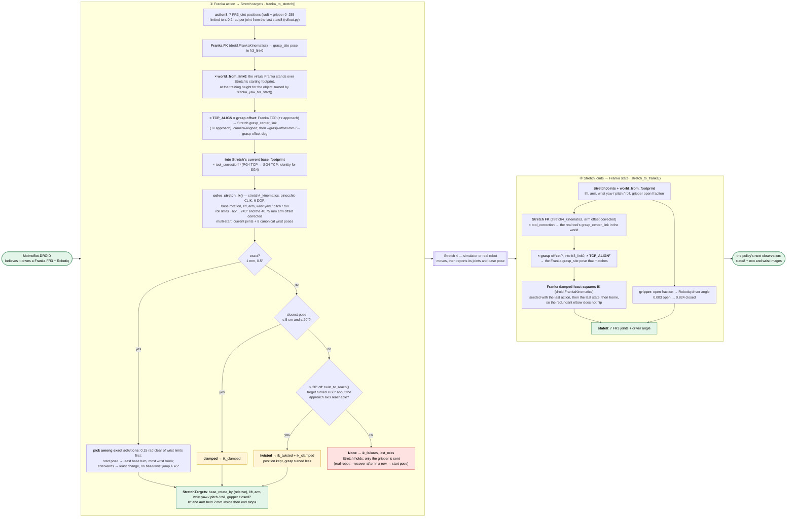
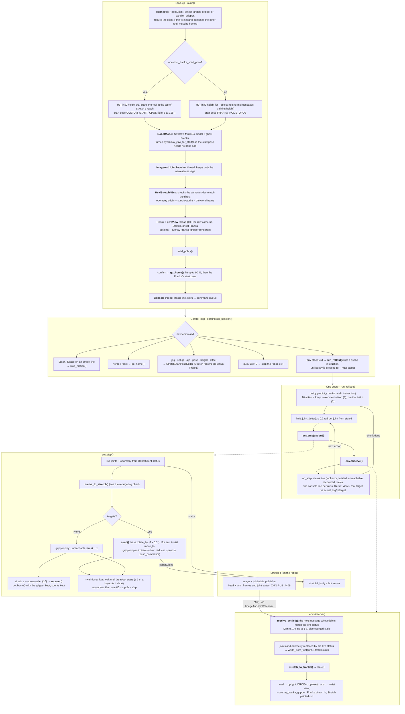

# Franka → Stretch 4 retargeting

How MolmoBot-DROID, a policy trained on a Franka FR3 with a Robotiq gripper, drives Stretch 4,
and how the two Stretch 4 runners use that. The flags, the frame conventions and the known
kinematics corrections are covered in the
[parent README](../README.md#retargeting-franka_retargetstretch4_retargetpy).

- [How retargeting works](#how-retargeting-works)
- [`run_stretch4_real.py`: the real robot](#run_stretch4_realpy-the-real-robot)
- [`run_stretch4_sim.py`: the simulator](#run_stretch4_simpy-the-simulator)

## How retargeting works

`FrankaStretchRetargeter` in [`stretch4_retarget.py`](stretch4_retarget.py) does the
retargeting, in two directions:

- **①** It turns each Franka action into Stretch 4 joint targets by matching the tool centre
  point (TCP).
- **②** It turns Stretch's measured joints back into the Franka state the policy expects.

The policy never learns it is not driving a Franka.



The PNG is rendered from [`docs/retargeting.mmd`](docs/retargeting.mmd), which is the same chart
as below.



### When Stretch cannot follow

Stretch can't always follow the Franka. Its lift tops out below a high Franka TCP, and its
wrist roll travels only from −65° to 245°. When it can't, the retargeter falls back in this
order:

1. **Clamped.** If the closest pose is within 5 cm and 20° of the target, Stretch goes there
   instead. Counted in `ik_clamped`.
2. **Twisted.** If the closest pose is more than 20° off, it is usually because the wrist
   can't turn the tool far enough about its approach axis. Stretch then goes to the target
   turned the least it needs about that axis, up to 60°.
   - The position is still tracked.
   - The Franka state reported back shows the wrist stopped, as if at a joint limit.
   - Counted in `ik_twisted`, and in `ik_clamped` too.
3. **Unreachable.** Otherwise, Stretch holds still and only the gripper command is sent.
   Counted in `ik_failures`.

`FrankaStretchRetargeter.last_miss` (a `ReachMiss`) records why the last action was twisted or
unreachable: how far off the closest pose was, and which joints were at their limits.

### Regenerating the PNG

```bash
npx -p @mermaid-js/mermaid-cli mmdc -i docs/retargeting.mmd -o docs/retargeting.png -b white --size 3200 -s 2
```

Run it from this directory. If you change `docs/retargeting.mmd`, copy the change into the chart
above.

## `run_stretch4_real.py`: the real robot

The policy runs on the workstation. Stretch 4 runs two things that the workstation talks to:

- **Image and joint publisher.** `send_gripper_and_head_images_with_joint_states.py -r`, from
  stretch4_compliant_gripper. It publishes synced head and wrist frames with joint states over
  ZMQ.
- **stretch4_body server.** Commands go to it through `RobotClient`, and the robot's status
  comes back the same way.

There is no scene to read the target's height from, so the virtual Franka is placed from
`--object-height`, or from `--custom_franka_start_pose`.



## `run_stretch4_sim.py`: the simulator

The same policy loop drives Stretch 4 in stretch4_mujoco, in any MolmoSpaces house. The
simulator runs the physics and renders Stretch's own cameras. A `SceneMirror`, which is a
kinematic copy of the scene in this process, renders the cameras the simulator doesn't have:
the scene camera, the DROID exo camera and the Franka overlays. Instructions are typed at a
prompt, and each one runs until `--max-steps` or Ctrl+C. Unlike the real robot, the sim has no
`--recover-after` backstop.

```mermaid
---
config:
  flowchart:
    wrappingWidth: 380
---
flowchart TB
    subgraph START["Start-up · main()"]
        direction TB
        SCENE["<b>load_custom_scene()</b>: --scene-id house, target --object-type / --object-index"]
        POSE["resolve_pose(): where Stretch stands (--robot-pose, or picked facing the object)"]
        HEIGHT{"--custom_franka_start_pose?"}
        H1["fr3_link0 at the top of Stretch's reach<br/>start pose CUSTOM_START_QPOS"]
        H2["fr3_link0 at molmospaces' training height for the object<br/>start pose FRANKA_HOME_QPOS"]
        YAW["franka_yaw_for_start(): how far the start pose would turn the base"]
        S4["<b>load_custom_scene_stretch4()</b>: Stretch spawned turned by −that yaw;<br/>furniture it would spawn inside removed; ghost Franka with<br/>--include_franka or --overlay_franka_gripper"]
        SPAWN["<b>spawn_stretch4()</b>: lift 90 % up, arm out; only the cameras in use;<br/>watched bodies (+ free objects nearby, for the overlay)"]
        SIMSTART["<b>sim.start()</b>: stretch4_mujoco simulator + passive viewer"]
        ENV["<b>Stretch4SimEnv</b> + <b>SceneMirror</b>; Rerun + StretchRerunLogger"]
        GO["<b>go_to_start()</b> → env.reset() → move_to_franka_pose():<br/>slowly, re-sent up to 5× until it arrives; counters reset"]
        LOAD["load_policy()"]
        SCENE --> POSE --> HEIGHT
        HEIGHT -- yes --> H1 --> YAW
        HEIGHT -- no --> H2 --> YAW
        YAW --> S4 --> SPAWN --> SIMSTART --> ENV --> GO --> LOAD
    end

    subgraph PROMPT["Prompt · rollout.interactive_session()"]
        direction TB
        CMD{"instruction&gt;"}
        RESET["reset → go_to_start()"]
        EDIT["jog · home · set q1…q7 · pose · height · offset<br/>→ StretchStartPoseEditor"]
        QUIT["quit → unload the policy, stop the simulator"]
        RUN["empty → the default pick instruction for the target;<br/>text → that instruction · <b>run_rollout()</b> until --max-steps or Ctrl+C"]
        CMD --> RESET & EDIT & QUIT & RUN
    end

    subgraph ROLL["One query · run_rollout()"]
        direction TB
        PRED["policy.predict_chunk(state8, instruction)<br/>16 actions; keep --execute-horizon (8), run the first n (2)"]
        LIMIT["limit_joint_delta(): ≤ 0.2 rad per joint from state8"]
        STEP["<b>env.step(action8)</b>"]
        OBS["<b>env.observe()</b>"]
        LOG["on_step: stop if the simulator stopped; StretchRerunLogger:<br/>mirror scene, exo / wrist / head_raw / gripper_raw / scene cameras,<br/>tool target vs actual, metrics (ik_failures, ik_clamped, tool error)"]
        PRED --> LIMIT --> STEP --> OBS --> LOG
        LOG -- "next action" --> LIMIT
        LOG -- "chunk done" --> PRED
    end

    subgraph STEPD["env.step()"]
        direction TB
        STATE["world_from_footprint from the stretch4 body pose,<br/>joints from pull_status()"]
        RT["<b>franka_to_stretch()</b> (see the retargeting chart)"]
        MISS{"targets?"}
        SEND["<b>send()</b>: sim base.rotate_by (if > 0.3°), lift / arm / wrist move_to,<br/>gripper aperture (--slow: reduced speeds)"]
        GONLY["gripper only"]
        WAIT["--wait-for-arrival: wait_command() (≤ 3 s);<br/>never less than 66 ms of simulated time"]
        STATE --> RT --> MISS
        MISS -- yes --> SEND --> WAIT
        MISS -- None --> GONLY --> WAIT
    end

    subgraph OBSD["env.observe()"]
        direction TB
        FRESH["<b>fresh_camera_data()</b>: wait for frames and body poses from after now<br/>(up to 1 s, else counted stale)"]
        BACK["pull_status() + pull_body_poses() → <b>stretch_to_franka()</b> → state8"]
        MIRROR["SceneMirror posed from the simulator; ghost Franka at state8"]
        EXO{"--exo_camera"}
        DROID["droid → the DROID shoulder camera, rendered in the mirror"]
        HEAD["left / right / center → Stretch's head camera, DROID crop"]
        OVER["--overlay_franka_gripper: exo and wrist rendered with the Franka<br/>in place of Stretch (mirror.render_with_franka)"]
        WRIST["wrist view from the gripper camera → Observation"]
        FRESH --> BACK --> MIRROR --> EXO
        EXO --> DROID & HEAD
        DROID --> OVER
        HEAD --> OVER
        OVER --> WRIST
    end

    START --> PROMPT
    RUN --> ROLL
    STEP -.-> STEPD
    OBS -.-> OBSD
```


